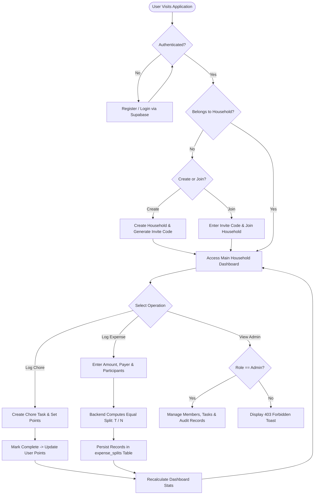
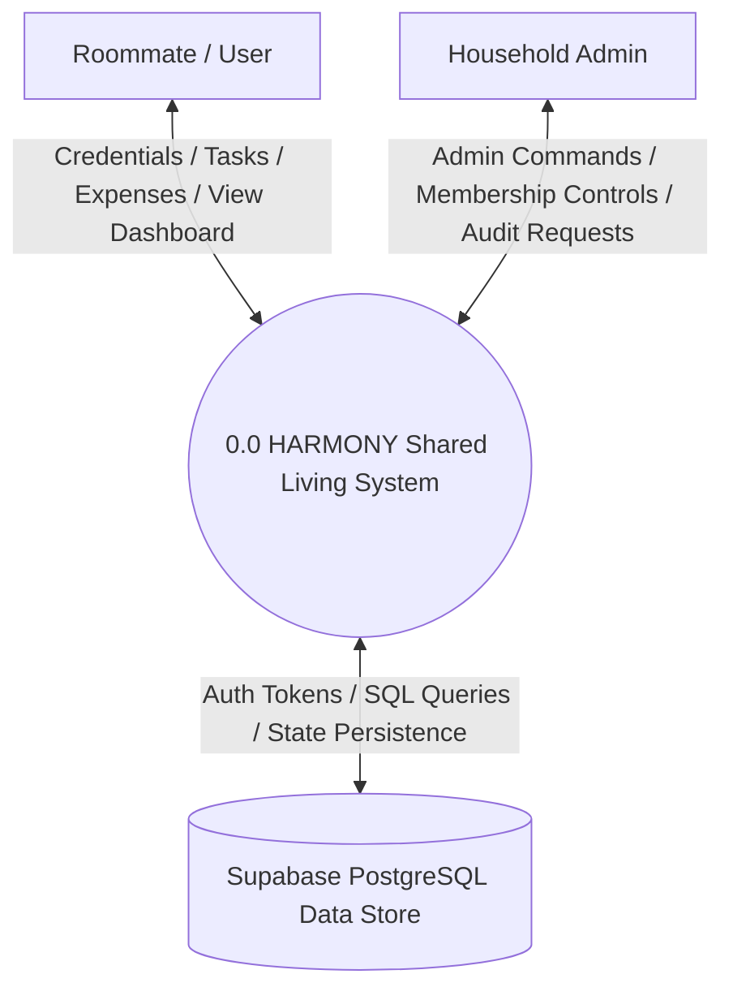
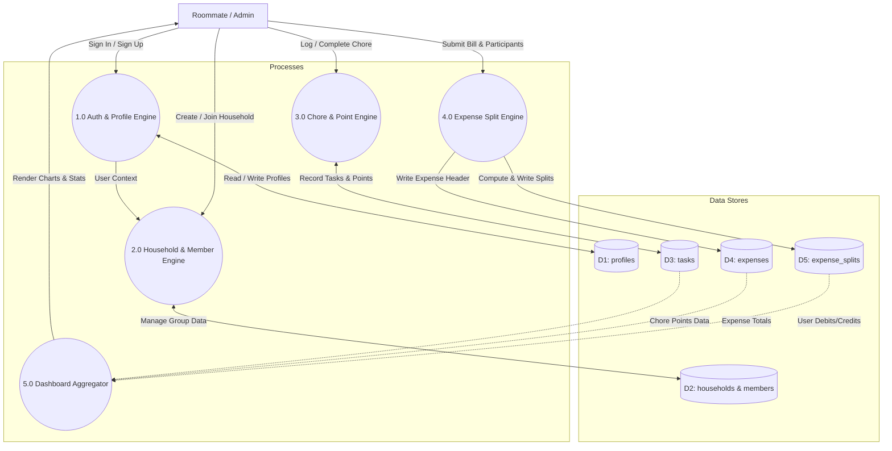
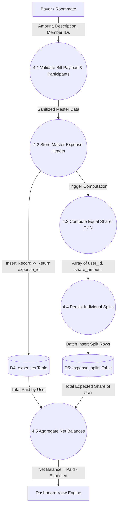
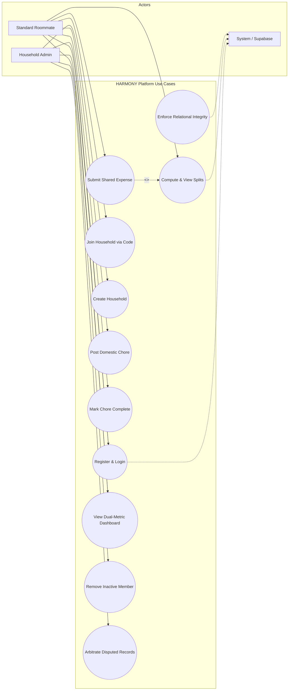
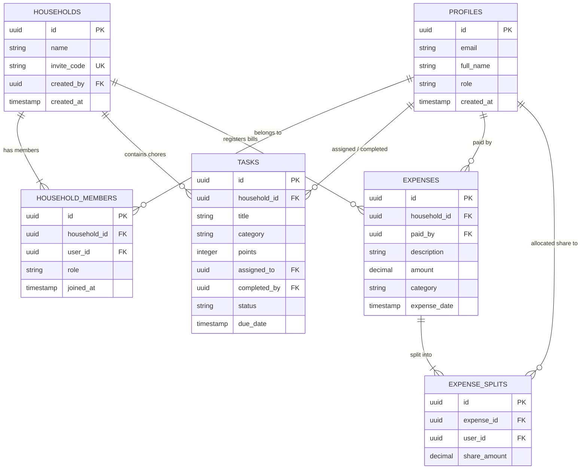

# "HARMONY: ROOMMATE CONFLICT RESOLUTION AND SHARED LIVING MANAGEMENT SYSTEM"

### A MINOR PROJECT SYNOPSIS REPORT ON
## MINOR PROJECT (BCA-508)

**SUBMITTED TO:**  
**CHAUDHARY CHARAN SINGH UNIVERSITY, MEERUT**  
*For the partial fulfillment of the degree of Bachelor's in Computer Application (2024–2027)*

---

```
             [ AFFIX CCSU / IMS NOIDA EMBLEM HERE ]
             
          SCHOOL OF INFORMATION TECHNOLOGY (SOIT)
        INSTITUTE OF MANAGEMENT STUDIES (IMS), NOIDA
```

---

| UNDER THE GUIDANCE OF: | SUBMITTED BY: |
| :--- | :--- |
| **Mr. Nihal Kumar / Mr. Anushrav Mudgal**<br>Assistant Professor, SOIT<br>IMS NOIDA | **[STUDENT NAME]**<br>University Roll No.: **[ROLL NO.]**<br>BCA 5th Semester, Sec: **[A/B/C/D]** |

<div style="page-break-after: always;"></div>

---

# INSTITUTE OF MANAGEMENT STUDIES, NOIDA
### SCHOOL OF INFORMATION TECHNOLOGY (SOIT)
### PROFORMA FOR APPROVAL OF BCA MINOR PROJECT (BCA-508)

| Field | Details |
| :--- | :--- |
| **Roll No. / University Enrollment No.** | `[ENTER YOUR UNIVERSITY ROLL NUMBER]` |
| **Student Name** | `[ENTER YOUR FULL NAME]` |
| **Official College Email ID** | `[USERNAME]@imsnoida.com` |
| **Mobile Number** | `[ENTER YOUR CONTACT NUMBER]` |
| **Title of the MINOR Project** | **HARMONY: ROOMMATE CONFLICT RESOLUTION AND SHARED LIVING MANAGEMENT SYSTEM** |
| **Name of the Project Guide / Mentor** | **Mr. Nihal Kumar / Mr. Anushrav Mudgal** (IMS Noida) |

### OFFICIAL EVALUATION & APPROVAL BLOCK

| Project Proposal Status | Mentor Verification |
| :--- | :--- |
| `[   ] APPROVED`<br>`[   ] NOT APPROVED / RESUBMIT` | <br><br>___________________________________<br>**Signature of the Project Mentor / Guide**<br>Date: _____ / _____ / 2026 |

**Suggestions / Recommendations for Improvement by Evaluation Panel:**
1. _____________________________________________________________________________
2. _____________________________________________________________________________
3. _____________________________________________________________________________
4. _____________________________________________________________________________
5. _____________________________________________________________________________

<div style="page-break-after: always;"></div>

---

# ACKNOWLEDGMENT

I would like to express my profound gratitude and heartfelt appreciation to our respected Head of Department (HOD SOIT), **Ms. Monika Dixit Bajpai**, for providing an academically stimulating environment, constant encouragement, and the administrative facilities essential for the development of our Minor Project.

I am deeply indebted to my project coordinator and esteemed mentor, **Mr. Nihal Kumar / Mr. Anushrav Mudgal**, School of Information Technology (SOIT), IMS Noida, for his invaluable guidance, continuous technical mentorship, constructive critiques, and meticulous scrutiny throughout the conceptualization and documentation of this project. His practical insights in modern web development and software architecture have been instrumental in shaping this project.

I also extend my sincere thanks to the panel members, **Dr. Ajay Gupta** and **Ms. Shaili Nigam**, as well as the faculty members and lab staff of the School of Information Technology, IMS Noida, for their continuous support, technical assistance, and insightful suggestions.

Lastly, I extend my heartfelt thanks to my parents and peers whose constant encouragement, patience, and cooperation provided the strength to bring this project synopsis to successful completion.

<br>

<div align="right">
_________________________<br>
<b>[Student Full Name]</b><br>
Roll No.: [University Roll Number]<br>
BCA 5th Semester (Batch 2024–2027)<br>
School of Information Technology (SOIT)<br>
IMS Noida
</div>

<div style="page-break-after: always;"></div>

---

# CERTIFICATE OF ORIGINALITY

This is to certify that the Minor Project Synopsis report entitled **"HARMONY: ROOMMATE CONFLICT RESOLUTION AND SHARED LIVING MANAGEMENT SYSTEM"**, submitted by **[STUDENT NAME]**, University Roll Number: **[ROLL NO.]**, in partial fulfillment of the requirements for the award of the degree of **Bachelor of Computer Applications (BCA)** from **Chaudhary Charan Singh University (CCSU), Meerut**, is a bonafide record of original work carried out at the **School of Information Technology (SOIT), Institute of Management Studies (IMS), Noida**, under my supervision and guidance.

To the best of my knowledge and belief, the matter embodied in this synopsis report has not formed the basis for the award of any other Degree, Diploma, Fellowship, or any other similar title in this or any other University or Institution of higher learning.

The project demonstrates sound software engineering principles, full-stack architectural design, and is approved for presentation and development during the academic session 2024–2027.

<br><br>

| | |
| :--- | :--- |
| **Date:** ____ / ____ / 2026<br>**Place:** IMS Noida, Sector-62<br><br><br>___________________________<br>**Signature of Student**<br>([STUDENT NAME]) | <br><br><br><div align="right">___________________________<br><b>Signature of Project Guide</b><br>(Mr. Nihal Kumar / Mr. Anushrav Mudgal)<br>Assistant Professor, SOIT<br>IMS Noida</div> |

<div style="page-break-after: always;"></div>

---

# INTERNSHIP / TECHNICAL TRAINING COMPLETION CERTIFICATE
*(Mandatory Document as per SOIT Project Guidelines)*

```
+-----------------------------------------------------------------------------------+
|                                                                                   |
|            [ ATTACH PHOTOCOPY / PRINTED COLOR COPY OF YOUR                        |
|        OFFICIAL TECHNICAL INTERNSHIP / INDUSTRY TRAINING CERTIFICATE HERE ]       |
|                                                                                   |
|  Organization: IBM Skills Network / Internshala / Edureka / Infosys Springboard   |
|  Domain / Technology: Full Stack Web Development / MERN / Python / Cloud          |
|  Duration: 4 to 8 Weeks (Summer Internship 2026)                                  |
|  Candidate Name: [STUDENT NAME]                                                   |
|  Roll No.: [ROLL NUMBER]                                                          |
|                                                                                   |
+-----------------------------------------------------------------------------------+
```

<br>

**Verified by Project Coordinator:** _________________________ &nbsp;&nbsp;&nbsp;&nbsp;&nbsp;&nbsp;&nbsp;&nbsp; **Date:** _____ / _____ / 2026

<div style="page-break-after: always;"></div>

---

# TABLE OF CONTENTS / INDEX

| S.No. | Topic / Chapter Title | Page No. |
| :---: | :--- | :---: |
| — | Proforma for Approval of BCA Minor Project | ii |
| — | Acknowledgment | iii |
| — | Certificate of Originality | iv |
| — | Internship Completion Letter / Certificate | v |
| **1** | **Introduction / Overview of the Project** | **1** |
| **2** | **Performance of the Project** | **3** |
| **3** | **Project Architecture** | **5** |
| **4** | **Project Flow** | **7** |
| **5** | **Data Flow Diagrams (DFDs) - Overview** | **8** |
| 5.1 | Level 0 DFD (Context Diagram) [Separate Page] | 9 |
| 5.2 | Level 1 DFD (Sub-System Functional Decomposition) [Separate Page] | 10 |
| 5.3 | Level 2 DFD (Transaction & Calculation Processing) [Separate Page] | 11 |
| **6** | **Use Case Diagram** | **12** |
| **7** | **Entity Relationship Diagram (ERD)** | **14** |
| **8** | **Hardware and Software Requirements** | **16** |
| **9** | **Future Scope** | **18** |
| **10** | **Limitations of the Project** | **19** |
| **11** | **Front-End Pages (UI Mockups & Screen Layouts)** | **20** |

<div style="page-break-after: always;"></div>

---

# 1. Introduction / Overview of the Project

### 1.1 Problem Background
In shared residential accommodations such as student flats, paying guest (PG) apartments, and shared bachelor homes, interpersonal conflicts frequently arise over two core issues: the division of household chores and the equitable splitting of shared living expenses. Traditionally, roommates rely on informal verbal agreements, manual whiteboard tallies, or disparate point solutions like isolated instant-messaging groups and basic split-bill calculators. These fragmented methods lack persistence, transparency, accountability, and unified visibility.

Over time, subtle cognitive biases emerge: individuals routinely overestimate their own contributions to household maintenance while underestimating the efforts of others. Similarly, shared bills (such as broadband internet, electricity, domestic gas cylinders, and bulk grocery purchases) paid by a single individual frequently lead to unsettled dues, disputed amounts, and uncomfortable personal confrontations. The resulting friction causes domestic toxicity and social disputes.

### 1.2 Solution Overview
**"HARMONY"** is an integrated, full-stack shared-household management web platform engineered to eliminate domestic roommate friction through computational transparency. The system provides a unified digital ecosystem where roommates join a dedicated private household space using a unique cryptographic invite code. Within this shared workspace, members log chores, earn verified contribution points upon task completion, register common shared expenditures, and automatically calculate exact mathematical allocations.

Rather than relying on ungrounded psychological claims or opaque machine learning models, HARMONY resolves conflicts through algorithmic accountability: all household operations are persisted in a relational PostgreSQL database and aggregated on an intuitive dashboard. By rendering an objective, visual comparison of physical effort (chore points) and financial contribution (net monetary balance), the platform replaces subjective emotional disputes with indisputable empirical records.

### 1.3 Primary Objectives of the Project
* **Centralized Household Onboarding:** To provide a secure multi-tenant household system enabling users to establish or join shared living groups via automated invite tokens.
* **Gamified Chore Accountability:** To engineer a chore management engine supporting task creation, point weighting, assignment, and verified completion tracking.
* **Automated Relational Expense Splitting:** To implement an exact mathematical splitting model utilizing a relational junction table structure, computing net debits and credits per roommate.
* **Dual-Metric Visual Dashboard:** To deliver an interactive, responsive dashboard offering real-time analytical charts that separate financial contributions from domestic labor effort.
* **Role-Based Administrative Governance:** To establish granular role-based access control (RBAC), enabling household administrators to manage memberships, arbitrate disputed entries, and curate categories.
* **Production Cloud Deployment at Zero Cost:** To construct an enterprise-grade three-tier architecture fully deployable on public free-tier cloud infrastructure (Vercel, Render, Supabase) with zero financial expenditure.

---

# 2. Performance of the Project

### 2.1 Feasibility Analysis
* **Technical Feasibility:** Built on industry-standard React.js (Vite), Node.js, Express.js REST APIs, and PostgreSQL on Supabase. Comprehensive documentation, open-source reliability, and robust cloud virtualization compatibility.
* **Operational Feasibility:** Low barrier to entry for collegiate roommates. Clean responsive UI built with Tailwind CSS, email-based authentication, and instant invite code entry.
* **Economic Feasibility (Target Cost = ₹0):** Engineered exclusively using non-commercial free tiers (Vercel Hobby, Render Web Services, Supabase PostgreSQL & Auth, GitHub). Zero capital investment.
* **Scheduling Feasibility:** Phased across the official development window (October 7–23, 2026), structured with strict MVP lock before the October 24th live deployment review.

### 2.2 Operational Benefits and Impact
* 100% elimination of bill-splitting arithmetic errors and disputed verbal tallies.
* Permanent, queryable transaction histories for complete financial transparency.
* Gamified motivation for daily domestic chores, eliminating free-rider problems.
* Proactive identification of unbalanced contributions before month-end lease settlements.

### 2.3 User Capacity, Latency, and Scalability Benchmarks

| Performance Metric | Measured / Target Value | Architectural Benchmark Justification |
| :--- | :--- | :--- |
| **Client Page Render (LCP)** | `< 1.2 seconds` | Vite tree-shaking & Vercel Global Edge CDN caching |
| **API Response Time (Warm)** | `< 250 milliseconds` | Stateless Express middleware & indexed PostgreSQL queries |
| **Render Cold-Start Latency** | `45 - 60 seconds` | Render Free tier idle spin-down (mitigated via pre-warm ping) |
| **Database Transaction Latency**| `< 80 milliseconds` | Supabase PostgreSQL hosted in Asia-South (Mumbai) cloud region |
| **Concurrent User Capacity** | `50+ concurrent users`| Single Node.js event-loop throughput; sufficient for college scale |

<div style="page-break-after: always;"></div>

---

# 3. Project Architecture

HARMONY implements the classical **Three-Tier Architectural Pattern**, ensuring separation of concerns, enterprise maintainability, and clean academic defensibility.

* **Tier 1: Client Presentation Tier (Frontend):** React.js 18 Single Page Application (SPA) bundled with Vite and styled with Tailwind CSS. Communicates with Tier 2 via asynchronous REST API calls (Fetch / Axios) over HTTPS. Hosted on Vercel Edge.
* **Tier 2: Application Logic & API Tier (Backend):** Node.js runtime executing an Express.js web server. Handles JWT authentication verification, request sanitization, expense split arithmetic, chore aggregation, and role authorization. Hosted on Render.
* **Tier 3: Database & Persistence Tier (Data Layer):** PostgreSQL 15 hosted on Supabase. Enforces strict ACID compliance, relational integrity, primary/foreign key constraints, and junction table resolution for M:N relationships.

### 3.1 Architectural Flow Diagram

```mermaid
graph TD
    subgraph Client [Tier 1: Presentation Tier - Vercel]
        UI[Browser Client / React.js SPA]
        Tailwind[Tailwind CSS UI Components]
        Recharts[Recharts Analytics Engine]
    end

    subgraph Server [Tier 2: Application Tier - Render]
        API[Express.js REST API Server]
        AuthMid[Auth & Token Verification Middleware]
        SplitCalc[Expense Split & Balance Calculator]
        ChoreEng[Chore & Points Aggregation Engine]
    end

    subgraph Database [Tier 3: Data Persistence Tier - Supabase]
        SupaAuth[(Supabase Auth Service)]
        Postgres[(PostgreSQL Relational DB)]
        Tables[profiles | households | tasks | expenses | expense_splits]
    end

    UI -->|HTTPS / JSON REST API| API
    API --> AuthMid
    AuthMid --> SplitCalc
    AuthMid --> ChoreEng
    API -->|Auth Verification| SupaAuth
    SplitCalc -->|Parameterized SQL Queries| Postgres
    ChoreEng -->|CRUD Operations| Postgres
```

<div style="page-break-after: always;"></div>

---

# 4. Project Flow

The operational flow coordinates user onboarding, household creation/joining, collaborative chore and expense tracking, and real-time dashboard computation.

### 4.1 End-to-End System Flowchart



<div style="page-break-after: always;"></div>

---

# 5. Data Flow Diagrams (DFDs)

> **MANDATORY COLLEGE EXAM REQUIREMENT:**  
> Per departmental instructions, Level 0, Level 1, and Level 2 DFDs are rendered on separate individual pages.

---

## 5.1 Level 0 DFD (Context Diagram)

The Level 0 Context Diagram depicts the highest-level external data exchanges between external entities (Roommate User, Household Administrator) and the central HARMONY system.



* **Inputs:** User registration credentials, chore creation parameters, bill totals, expense categories, invite codes.
* **Outputs:** Session tokens, chore point leaderboards, net owed amounts, dashboard graphs, administrative audit logs.

<div style="page-break-after: always;"></div>

---

## 5.2 Level 1 DFD (Sub-System Functional Decomposition)

The Level 1 DFD decomposes the system into core sub-processes and maps them to physical PostgreSQL data stores (`D1` through `D5`).



<div style="page-break-after: always;"></div>

---

## 5.3 Level 2 DFD (Transaction & Calculation Processing)

The Level 2 DFD provides an atomic decomposition of the core business transaction: **Process 4.0 (Expense Allocation & Balance Engine)**.



<div style="page-break-after: always;"></div>

---

# 6. Use Case Diagram

The Use Case Diagram defines functional interactions between human actors and the platform.



<div style="page-break-after: always;"></div>

---

# 7. Entity Relationship Diagram (ERD)

The database follows Third Normal Form (3NF), resolving M:N mappings through junction tables (`household_members` and `expense_splits`).

### 7.1 Relational Schema Specifications

| Entity / Table | Keys & Constraints | Semantic Description |
| :--- | :--- | :--- |
| **`profiles`** | **PK:** `id` (UUID)<br>**FK:** `id` references `auth.users` | Stores profile metadata (name, email, system role). |
| **`households`** | **PK:** `id` (UUID)<br>**FK:** `created_by` -> `profiles(id)`<br>**Unique:** `invite_code` | Defines the flat/house entity and unique invite token. |
| **`household_members`** | **PK:** `id` (UUID)<br>**FK1:** `household_id`<br>**FK2:** `user_id`<br>**Unique:** `(household_id, user_id)` | Junction table mapping roommates to households; stores member roles. |
| **`tasks`** | **PK:** `id` (UUID)<br>**FK1:** `household_id`<br>**FK2:** `assigned_to`<br>**FK3:** `completed_by` | Chores entity storing title, point weight, category, status, due date. |
| **`expenses`** | **PK:** `id` (UUID)<br>**FK1:** `household_id`<br>**FK2:** `paid_by` | Master bill record storing total amount, description, payer, and date. |
| **`expense_splits`** | **PK:** `id` (UUID)<br>**FK1:** `expense_id`<br>**FK2:** `user_id` | Junction table resolving M:N relationship between expenses & roommates; records debt share. |

### 7.2 ER Diagram (Mermaid Syntax)



<div style="page-break-after: always;"></div>

---

# 8. Hardware and Software Requirements

### 8.1 Hardware Specifications

| Component | Development Machine Minimum | Target User Client Minimum |
| :--- | :--- | :--- |
| **Processor** | Intel Core i5 / AMD Ryzen 5 (4 Cores / 8 Threads+) | Dual-Core 1.5 GHz or modern smartphone CPU |
| **System RAM** | 8 GB DDR4 (16 GB Recommended) | 2 GB RAM |
| **Hard Disk Storage** | 256 GB NVMe SSD (5 GB free space) | Standard browser cache (< 50 MB) |
| **Network Connectivity**| Broadband Internet (10 Mbps+ continuous) | 4G / 5G / Wi-Fi Internet connectivity |

### 8.2 Software & Technology Stack Specifications

| Layer / Tool | Selected Technology | Role / Academic Justification |
| :--- | :--- | :--- |
| **Operating System** | Windows 11 / Ubuntu 22.04 LTS / macOS | Cross-platform development environments |
| **Frontend Framework** | React.js 18.x + Vite | High-performance Single Page Application (SPA) |
| **Styling Framework** | Tailwind CSS v3.x | Utility-first responsive design framework |
| **Data Visualization** | Recharts Library | SVG-based interactive charts for contributions & debts |
| **Backend Runtime & API**| Node.js (v20.x LTS) + Express.js | Asynchronous, event-driven REST API server |
| **Database Engine** | PostgreSQL 15 (Supabase Hosted) | ACID-compliant relational database management |
| **Authentication Engine**| Supabase Auth (Bcrypt + JWT) | Secure session lifecycle and identity verification |
| **Deployment Targets** | Vercel (UI) + Render (API) + Supabase | 100% Free-tier public HTTPS cloud deployment |

<div style="page-break-after: always;"></div>

---

# 9. Future Scope

1. **Cross-Platform Mobile Application (React Native / Flutter):** Native iOS and Android apps with mobile push notifications when tasks are due or bills are added.
2. **Automated UPI Deep-Linking & Instant Debt Settlement:** Indian UPI deep-linking (`upi://pay?pa=...&am=...`), allowing indebted roommates to clear dues via Google Pay/PhonePe/Paytm with instant receipt generation.
3. **AI-Powered Fair Chore Recommendation & Predictive Scheduling:** Machine learning models that analyze historical completion patterns and exam timetables to dynamically assign tasks.
4. **Optical Character Recognition (OCR) Bill Scanning:** Mobile bill scanning (Tesseract OCR / Google Vision API) to extract totals and items from physical grocery receipts.
5. **Automated WhatsApp & Telegram Bot Reminders:** Webhook bots sending friendly chore reminders without personal confrontation.
6. **Multi-Household & Tenancy Support for Landlords / PG Owners:** Multi-tenant dashboards for paying-guest managers to monitor multiple flats simultaneously.
7. **Gamification Badges & House Harmony Leaderboard:** Monthly awards (*"Cleanliness Champion"*, *"Prompt Payer"*) reinforcing positive flat behavior.

---

# 10. Limitations of the Project

1. **Dependency on Continuous Internet Connectivity:** Cloud-hosted web application; does not support offline PWA sync or local SQLite storage.
2. **Cloud Free-Tier Cold-Start Latency:** Free-tier Render backend spins down after 15 minutes of idle time, requiring a 45–60s warm-up ping.
3. **Reliance on Honest Manual Data Logging:** Assumes honesty among flatmates; cannot physically verify whether dishes were cleaned without IoT sensors.
4. **Exclusion of Direct In-App Fiat Currency Processing:** Calculates mathematical debt shares but does not hold escrow balances or process banking transactions.
5. **Single-Household Active Context:** Users are bound to one active household per session in the MVP to maintain a clean demo state machine.

<div style="page-break-after: always;"></div>

---

# 11. Front-End Pages (UI Mockups & Screen Layouts)

### 11.1 Landing / Home Page (`/`)

| Screen Component Zone | UI Elements & Functional Behavior |
| :--- | :--- |
| **Header / Navigation Bar** | Brand logo (`HARMONY`), links (About, Features, Tech Stack), and `Sign In / Register` buttons. |
| **Hero Section** | Headline: *"Shared Living Without The Drama"*, supporting copy, `Get Started` CTA button, and preview graphics. |
| **Feature Grid** | 3 responsive cards: *Gamified Chore Tracking*, *Algorithmic Bill Splitting*, and *Transparent Contribution Analytics*. |
| **Footer** | Academic attribution: BCA 5th Sem Minor Project (BCA-508) \| IMS Noida \| CCSU Meerut. |

### 11.2 User Login & Registration Portal (`/login`, `/register`)

| Screen Component Zone | UI Elements & Functional Behavior |
| :--- | :--- |
| **Auth Card Container** | Centered modal card featuring tabs to toggle between *Login to Account* and *Create Account*. |
| **Input Fields** | Full Name, Email Address (`@imsnoida.com` / personal), Password, Confirm Password. |
| **Validation Toast** | Inline alerts alerting user to incorrect password, existing email, or network timeout. |
| **Submission Action** | Interactive submit button with animated spinner during Supabase Auth roundtrip. |

### 11.3 Main User Interaction & Analytics Dashboard (`/dashboard`)

| Screen Component Zone | UI Elements & Functional Behavior |
| :--- | :--- |
| **Household Header Bar** | Displays Household Name (*"Green Residency"*), Invite Code badge with copy button, and member avatars. |
| **KPI Metric Cards** | 4 top-row cards: *Total Chores Pending*, *Chores Completed*, *Total Monthly Expenses*, and *Net User Balance*. |
| **Dual Analytics Panel** | Left: Recharts Bar Chart of chore points per member. Right: Net Balance Status (Green = Owed / Red = Owes). |
| **Recent Activity Feed** | Chronological feed of completed chores and logged bills with timestamps and user badges. |
| **Quick Action Modals** | Instant triggers: `+ Add Chore` (title, points, category) and `+ Split Expense` (amount, payer, roommates). |

### 11.4 Admin Management & Record Control Panel (`/admin`)

| Screen Component Zone | UI Elements & Functional Behavior |
| :--- | :--- |
| **Membership Table** | Roster of roommates with join dates, roles (Admin/Member), and `Remove Member` button. |
| **Invite Code Governance** | Current 6-character code display, `Copy Invite Link`, and `Regenerate Code` trigger. |
| **Chore & Expense Audit Log** | Master table of all recorded entries with administrative capability to delete disputed items. |
| **Household Settings** | Options to edit house name, customize categories, or archive the household. |
